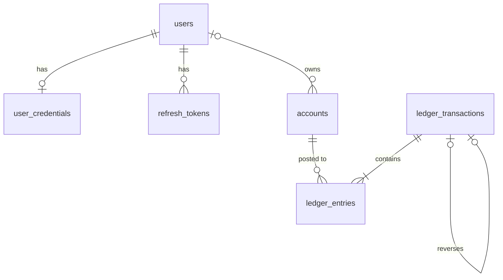

# Ledger design

## Principles
- Every movement of money is a **ledger transaction** made of two or more **entries**.
- Within a transaction, total debits equal total credits.
- Entries are immutable. Mistakes are corrected with a reversing transaction that
  references the original; entries are never updated or deleted.
- Money is stored in minor units (paise) as BIGINT. Never floating point.
- A balance is derived from entries. (Day 5 adds a cached balance, reconciled against entries.)

## Accounts
| Type   | Examples                         | Normal side | Increases with |
|--------|----------------------------------|-------------|----------------|
| WALLET | each user's wallet (we owe them) | CREDIT      | credits        |
| ASSET  | BANK_SETTLEMENT (money we hold)  | DEBIT       | debits         |
| INCOME | FEE_INCOME (fees we've earned)   | CREDIT      | credits        |

A user's own bank (SBI, HDFC, ...) is not a ledger account. It is information attached
to the transaction.

## Worked examples
Top-up of Rs 1,000:   DEBIT BANK_SETTLEMENT 100000 / CREDIT wallet 100000
Transfer Rs 250 + Rs 5 fee (one transaction):
DEBIT sender wallet 25500 / CREDIT receiver wallet 25000 / CREDIT FEE_INCOME 500

## Enforcement
| Rule                      | Enforced by                                           |
|---------------------------|-------------------------------------------------------|
| amount > 0, valid direction | DB CHECK constraints, plus the LedgerEntry constructor |
| wallet has an owner, system account has none | DB CHECK on accounts (chk_accounts_owner) |
| a transaction is reversed at most once | UNIQUE (reverses_transaction_id)         |
| debits = credits          | one writer class in code (Day 5), tests, reconciliation query |
| entries never change      | no setters, @Immutable, later DB grants (phase 5.5)   |

## Reconciliation query (must return zero rows)
```sql
SELECT fk_ledger_transaction_id,
       SUM(CASE direction WHEN 'DEBIT' THEN amount_minor ELSE -amount_minor END) AS imbalance
FROM ledger_entries GROUP BY fk_ledger_transaction_id HAVING imbalance <> 0;
```

## Data model
